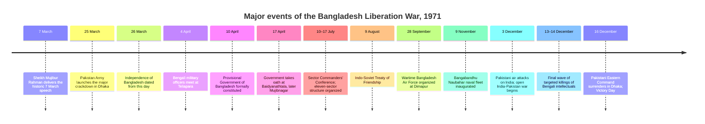

# Verified MCQ Dataset on the 1971 Liberation War of Bangladesh

## Executive summary

A **300-question, machine-readable JSON assessment bank** has been prepared on the 1971 Liberation War of Bangladesh. Every item contains exactly four distinct options labeled A–D, a correct option letter and answer text, a concise explanation, one or more source URLs, an explicit answer-citation field, a verification status, and a `disputed_fact` flag. The finished JSON was programmatically validated for all 300 records, including option count, answer-letter consistency, source presence, and metadata integrity.

The research base gives priority to the **Liberation War Museum, Banglapedia, Bangladesh Army and Bangladesh Navy, UNESCO, and primary diplomatic records in the U.S. Department of State's Foreign Relations of the United States series**. These sources jointly support the central chronology: the Awami League won 167 of East Pakistan's 169 National Assembly seats in 1970; the historic 7 March speech preceded the Pakistan Army's 25 March crackdown; independence is dated from 26 March; the provisional government was constituted on 10 April and sworn in at Baidyanathtala/Mujibnagar on 17 April; the resistance was ultimately organized into eleven sectors; and the war ended with the surrender in Dhaka on 16 December 1971. citeturn20view1turn8view0turn7view5turn20view3

The dataset intentionally avoids turning **contested aggregate casualty and sexual-violence estimates into ordinary single-answer factual questions**. It does, however, preserve three useful historiographical questions where authoritative institutional sources disagree about sector headquarters, and each is explicitly marked as disputed/source-dependent rather than silently choosing one account.

**[Download the complete validated 300-question JSON dataset](sandbox:/mnt/data/bangladesh_1971_liberation_war_300_verified_mcqs.json)**

The 300 questions are distributed as follows:

| Topic | Questions |
|---|---:|
| Military sectors | 106 |
| Provisional government and Proclamation | 50 |
| International context | 35 |
| Political background | 30 |
| Military organization and forces | 30 |
| Chronology and synthesis | 18 |
| Gallantry and historical memory | 16 |
| Atrocities and humanitarian impact | 15 |
| **Total** | **300** |

The large sector component reflects the unusually rich official Bangladesh Army documentation of operational areas, commanders, headquarters and subsectors, while the political and governmental questions rely especially heavily on the Liberation War Museum and Banglapedia. citeturn8view0turn14view1turn14view3turn14view4turn14view5turn15view0turn15view1turn15view2turn15view3turn15view4turn15view5

## Research and verification method

The questions were built from **source-level factual propositions rather than from unsourced general recollection**. Banglapedia was especially useful because it gives an integrated chronology of the conflict: the Awami League's 167-seat result, the refusal to transfer power, the 25 March crackdown, the 26 March declaration, the 4 April Teliapara military meeting, formation of the government on 10 April, organization of eleven sectors during the 10–17 July commanders' conference, and the 16 December conclusion of the war. citeturn20view1

For constitutional and governmental questions, the Liberation War Museum reproduces the substance of the Proclamation of Independence: Bangladesh was constituted as a sovereign People's Republic on principles including equality, human dignity and social justice; Sheikh Mujibur Rahman was President, Syed Nazrul Islam Vice-President; and the Vice-President was empowered to exercise presidential authority when the President was unavailable. The same museum record identifies Tajuddin Ahmad as Prime Minister and records the 17 April oath ceremony. citeturn8view0 The reproduced Proclamation text independently confirms the electoral mandate, President and Vice-President, and the language concerning equality, human dignity and social justice. citeturn17search4

Military-sector facts were checked against the **official Bangladesh Army sector pages** and, where possible, against the Liberation War Museum or Banglapedia. This is important because the sources are not perfectly identical. The Army's records identify, among other details, Harina with Sector 1, Sector 2's Dhaka-Comilla-Faridpur operational area, Mir Shawkat Ali with Sector 5, Khademul Bashar with Sector 6, the Rajshahi-Pabna-Bogra region with Sector 7, M A Jalil with Sector 9, Sector 10 with naval commandos, and Abu Taher/Hamidullah with Sector 11. citeturn15view0turn13search2turn14view3turn14view4turn14view5turn15view3turn15view4turn15view5

International and end-of-war questions were cross-checked against both South Asian historical sources and diplomatic archives. The U.S. State Department's retrospective account describes the massive refugee movement into India, the August 1971 India-Soviet treaty, China's alignment with Pakistan, the move of the USS *Enterprise* carrier group, and the beginning of open India-Pakistan war on 3 December following Pakistani air attacks. citeturn20view0 A contemporaneous 5 December letter from Indian Prime Minister Indira Gandhi to President Richard Nixon records attacks on places including Srinagar, Amritsar, Pathankot, Ambala, Agra and Jodhpur, states that Pakistan declared a state of war on 4 December, and gives the Indian government's contemporary figure of approximately ten million East Bengali refugees in India. citeturn20view2

The surrender questions use Banglapedia together with Bangladesh Navy's official record. Banglapedia places the signing at Ramna Racecourse, now Suhrawardy Udyan, on 16 December, with Lt. Gen. A. A. K. Niazi signing for Pakistan and Lt. Gen. Jagjit Singh Aurora accepting the surrender as commander of the joint forces; it also records A. K. Khandaker as the Bangladesh Forces representative. Bangladesh Navy independently states that the Pakistan Army surrendered to the joint forces of India and Bangladesh on 16 December and that the date is celebrated as Victory Day. citeturn20view1turn20view3

For the opening phase and atrocities, the dataset combines Banglapedia with contemporary U.S. diplomatic reporting instead of relying on later numerical claims. Banglapedia identifies Operation Searchlight, Tikka Khan's overall command, attacks on Dhaka University and particularly targeted Hindu areas of old Dhaka. U.S. diplomatic records from late March separately reported a “reign of terror,” killings of students and faculty at Dhaka University, and particular targeting of Hindus. citeturn20view1turn7view4

For historical memory, UNESCO provides an unusually strong institutional source for the historic 7 March speech: it records the speech as extempore, notes the survival of audio and audiovisual documentation, gives 2016 as the nomination year, and records its inclusion in the Memory of the World Register in 2017. citeturn7view5 Bangladesh Army supplies the official list of the seven Bir Sreshtho and biographical details used for Hamidur Rahman questions. citeturn7view3

Each JSON question therefore carries a verification label such as `cross-verified`, `single-source—official`, `single-source—authoritative`, or `single-source—primary`. A single-source label does **not** mean the proposition is considered doubtful; it means that, for the precise detail being tested—for example an official Army subsector name—the research set contained one source sufficiently authoritative to support that exact wording.

## Source reliability comparison

| Source type | Principal sources used | Reliability for this dataset | Best use | Important limitation |
|---|---|---|---|---|
| Official Bangladeshi military records | Bangladesh Army sector pages, Bir Sreshtho page, chiefs list; Bangladesh Navy awards page | **Very high** for institutional organization, official award records and military nomenclature | Sectors, subsectors, commanders, awardees, Victory Day | Individual institutional pages sometimes differ from museum accounts on headquarters or transition details. citeturn7view3turn20view3turn15view0turn15view5 |
| Liberation War Museum | History, Emergence of Bangladesh, 17 April chronology | **High** | Proclamation, Mujibnagar government, sector structure, wartime political and military organization | Some detailed sector-headquarters data differ from Army pages; numerical wartime-loss estimates require historiographical qualification. citeturn8view0turn8view1turn7view2turn0search14 |
| Banglapedia | *War of Liberation, The*; *Chhota Sona Mosque* | **High** | Integrated chronology, Teliapara, sectors, brigades, refugees, final campaign and surrender | Encyclopedia rather than a contemporaneous primary record; exceptionally precise details are preferably corroborated. citeturn20view1turn12search2 |
| UNESCO | Memory of the World record for the 7 March speech | **Very high** for archival and inscription facts | Date, documentary form, nomination and registration of the speech | Designed as a documentary-heritage record, not a complete political history of 1971. citeturn7view5 |
| FRUS / U.S. diplomatic archive | U.S. Department of State Office of the Historian | **Very high as primary evidence** for what diplomats and governments reported contemporaneously | March crackdown reports, India-Pakistan escalation, refugee figure in Gandhi's letter | A diplomatic document proves what the author/government reported; evaluative claims within it still reflect the author's perspective. citeturn7view4turn20view2 |
| U.S. State Department historical synthesis | *The South Asia Crisis and the Founding of Bangladesh, 1971* | **High** | International diplomatic setting and U.S.-Soviet-Chinese policy | Retrospective U.S. institutional interpretation rather than a Bangladeshi primary source. citeturn20view0 |
| Major newspaper archive | *The Daily Star* | **Medium-high**, used only as supplementary corroboration | 1970 election and contextual historical discussion | Secondary journalistic account; not used to override primary/official sources. citeturn10search9 |
| Political-party archival reproduction | Awami League reproduction of the Proclamation | **Medium-high for the reproduced text; lower as neutral interpretation** | Corroborating wording of the Proclamation | Institution is politically interested, so the dataset does not depend on it alone for contentious interpretations. citeturn17search4 |

The most important reliability principle in the dataset is **source fitness rather than a single universal hierarchy**. An Army page is exceptionally strong for its own official subsector list; UNESCO is stronger for the Memory of the World registration; FRUS is stronger for the content of a 1971 diplomatic report; and the museum/Banglapedia are better suited to synthesizing the Bangladeshi wartime chronology. Cross-source agreement was favored whenever the proposition was broad enough to permit it. citeturn20view1turn7view5turn20view2

## Major-event timeline

The timeline below uses only events that are strongly anchored in the cited source base: the 7 March address; the 25 March crackdown; the 26 March declaration; the 4 April Teliapara meeting; creation of the provisional government on 10 April and its oath on 17 April; the July sector-command structure; the August Indo-Soviet treaty; the September wartime air-force organization; the November naval-fleet milestone; the 3 December expansion to open India-Pakistan war; and the 16 December surrender. citeturn7view5turn20view1turn8view0turn20view0turn20view3



The chronology also shows why several common dates must not be conflated. **26 March** is the effective independence/declaration date; **10 April** is the date of formal constitution of the provisional government and the Proclamation; **17 April** is the public oath ceremony; and **16 December** is the date of surrender and victory. citeturn8view0turn20view1turn20view3

## JSON dataset and schema

The complete dataset is available here:

**[Download `bangladesh_1971_liberation_war_300_verified_mcqs.json`](sandbox:/mnt/data/bangladesh_1971_liberation_war_300_verified_mcqs.json)**

The file is a top-level JSON object containing a `metadata` block followed by the full `questions` array. Metadata records the 300-question total, generation date (`2026-10-13`), language (`en-US`), verification policy, category counts, disputed-question IDs, and a source catalogue with source type, reliability note, URL and question-usage count.

Each question follows this structure:

```json
{
  "id": "LW1971-001",
  "category": "Political background",
  "difficulty": "medium",
  "question": "In the 1970 general election, how many of East Pakistan's 169 National Assembly seats did the Awami League win?",
  "options": {
    "A": "165",
    "B": "169",
    "C": "167",
    "D": "160"
  },
  "correct_option": "C",
  "correct_answer": "167",
  "explanation": "The Awami League won 167 of the 169 National Assembly seats allocated to East Pakistan, giving it an overall majority in the National Assembly.",
  "sources": [
    {
      "url": "https://en.banglapedia.org/index.php/War_of_Liberation,_The"
    },
    {
      "url": "https://www.thedailystar.net/opinion/straight-line/news/71-years-awami-league-1918781"
    }
  ],
  "verification": {
    "status": "cross-verified",
    "note": "Fact is supported by two or more independent authoritative/reputable sources."
  },
  "disputed_fact": false,
  "answer_citations": [
    "https://en.banglapedia.org/index.php/War_of_Liberation,_The",
    "https://www.thedailystar.net/opinion/straight-line/news/71-years-awami-league-1918781"
  ]
}
```

That first item's answer is independently consistent with Banglapedia's statement that the Awami League won 167 of 169 seats and became the majority party in the Pakistan National Assembly. citeturn20view1turn10search9

The answer letters were deliberately distributed across the assessment rather than leaving correct answers systematically in the first position: the validated set contains **71 A answers, 75 B answers, 79 C answers and 75 D answers**. The file also contains **446 individual source references across the 300 questions**, allowing many questions to carry more than one citation.

The source catalogue embedded in metadata contains **25 distinct URLs**, including all eleven Bangladesh Army sector records, the Army's Bir Sreshtho and senior-command records, Bangladesh Navy, three Liberation War Museum resources, two Banglapedia entries, UNESCO, two primary FRUS resources, the State Department historical synthesis, a major Bangladeshi newspaper archive, and a corroborating reproduction of the Proclamation.

## Quality controls and disputed facts

The finished JSON passed programmatic checks confirming that there are exactly **300 question objects**, every object contains exactly **four distinct option values**, every `correct_option` is one of `A`, `B`, `C`, or `D`, every correct letter resolves to the stored `correct_answer`, and every item contains at least one answer citation. The resulting UTF-8 JSON file is 333,942 bytes.

The verification labels make an important distinction. **Cross-verified items** are used where two or more independent or institutionally distinct sources support the fact—for example, Tajuddin Ahmad's premiership, the eleven-sector structure, the broad surrender chronology, or the Pakistan-to-Bangladesh political transition. citeturn8view0turn20view1turn20view3 **Single-source—official** items are concentrated largely in fine-grained data such as individual Army subsector lists, where the official Army sector record is the natural source and creating a second citation merely for appearance's sake would not improve evidentiary quality. citeturn15view0turn14view5turn15view5

Three items are deliberately flagged as source-dependent rather than harmonized:

| JSON ID | Issue | Treatment |
|---|---|---|
| `LW1971-116` | Sector 4 headquarters | Bangladesh Army gives an initial Karimganj headquarters followed by Masimpur, whereas the Liberation War Museum presents a differing headquarters reference. The item identifies the Army version as source-specific rather than universally uncontested. citeturn15view1turn8view0 |
| `LW1971-120` | Sector 5 headquarters | Bangladesh Army gives **Banshtala**; the Liberation War Museum gives **Shillong**. The MCQ asks students to recognize the discrepancy itself. citeturn14view3turn8view0 |
| `LW1971-121` | Sector 8 headquarters | Bangladesh Army gives **Benapole**; the Liberation War Museum gives **Kalyani**. Again, the disagreement is the tested fact rather than one source being silently preferred. citeturn15view2turn8view0 |

The same caution was applied to other sensitive matters. Contemporary and institutional sources clearly document mass violence, attacks on Dhaka University, targeting of Hindus, large-scale refugee flight, and the activities of collaboration organizations, so those topics are included. citeturn20view1turn7view4turn20view2 By contrast, the bank does not ask students to memorize a single supposedly uncontested total number of people killed or women subjected to sexual violence, because such aggregate estimates require historiographical qualification rather than being treated as simple four-option recall facts.

The result is therefore a **student-assessment dataset rather than a collection of trivia**: it covers electoral and constitutional origins, the Proclamation and Mujibnagar government, resistance organization, all eleven sectors, regular and irregular forces, international diplomacy, refugees and atrocities, the December campaign and surrender, gallantry, and historical memory, while encoding evidentiary strength directly into each question object.