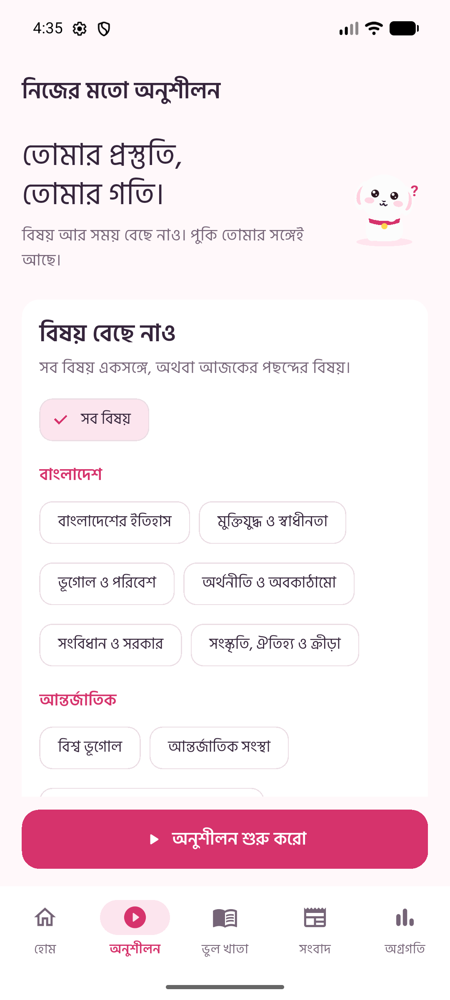
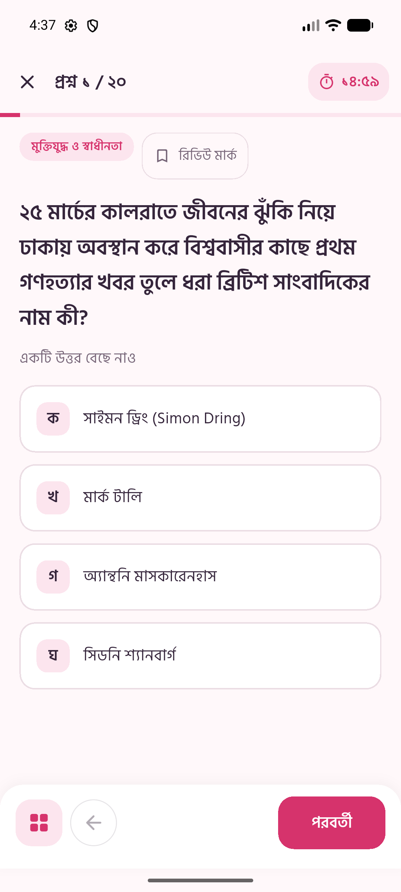
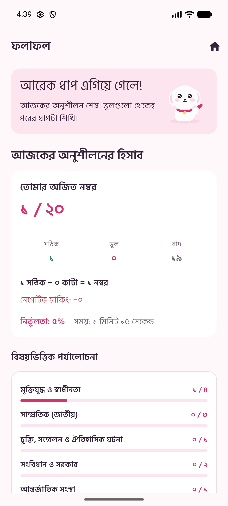

# Pookie Prep (পুকি প্রেপ) 🌸🐶

<p align="center">
  
</p>

<p align="center">
  <b>A stress-free, Bengali-first General Knowledge (GK) preparation app for Bangladesh Medical Admission Test (MAT) aspirants.</b><br>
  <i>Designed with a soothing soft-pink aesthetic, friendly mascot encouragement, and rigorous exam-accurate negative marking.</i>
</p>

<p align="center">
  <a href="https://github.com/borno18/PookiePrep/releases/tag/v.1.1"></a>
  <a href="https://flutter.dev"></a>
  <a href="https://dart.dev"></a>
  <a href="#"></a>
  <a href="#"></a>
</p>

---

## 📥 Download APK (Latest Release)

Install the application directly on your Android device:

| Download Source | Link | Description |
| :--- | :--- | :--- |
| 🚀 **Direct Download (APK)** | [**Download pookie-prep-v1.1.apk**](https://github.com/borno18/PookiePrep/releases/download/v.1.1/pookie-prep-v1.1.apk) | **Fast direct download** from GitHub Releases (~49.7 MB) |
| 📦 **Repository Mirror** | [**Browse in Repository (`apk/`)**](apk/pookie-prep-v1.1.apk) | Local APK binary tracked in repo |
| 🏷️ **GitHub Release Page** | [**View Release v.1.1 Notes**](https://github.com/borno18/PookiePrep/releases/tag/v.1.1) | Release notes, changelog & assets |

### 📋 Installation Details
* **Version:** `1.1.0` (Build `v.1.1`)
* **Minimum Android Version:** Android 5.0 (Lollipop, API Level 21) or above
* **Recommended Android Version:** Android 10+
* **Package Name:** `com.borno.pookie_prep`
* **SHA-256 Checksum:** `AF33EFE974DBA80082FEAC02457EEDBC13A914D333F08FC58EA780AD664F0C92`

> [!TIP]
> **Android Installation Tip:** When installing from outside Google Play Store, allow **"Install unknown apps"** in your browser or file manager settings when prompted.

---

## 📸 App Preview

<p align="center">
  
  &nbsp;&nbsp;
  
  &nbsp;&nbsp;
  
  &nbsp;&nbsp;
  
</p>

<p align="center">
  <i>(Left to right: Custom Practice Setup, Live Exam Mode with Palette Sheet, Result Breakdown with Mascot, Mistake Notebook)</i>
</p>

---

## 🌸 Why Pookie Prep?

Medical admission preparation in Bangladesh is notoriously high-pressure. General Knowledge (১০ নম্বর) often becomes a source of anxiety due to uncurated question banks and punitive interfaces. 

**Pookie Prep** transforms this experience into a joyful, confidence-building routine:
1. **Pookie the Mascot 🐶:** A custom vector-drawn white puppy reacts dynamically across 5 emotional states (`Greeting`, `Thinking`, `Cheering`, `Sleepy`, `Encouraging`) to keep learners motivated without shaming.
2. **Bengali-First Typography:** Handcrafted Bengali numerals (`০১২৩৪৫৬৭৮৯`), Bengali dates, and Hind Siliguri typography throughout all countdowns, scores, and questions.
3. **True Exam Simulation:** Strict MAT rules (+1.0 for correct answers, **−0.25 negative marks** per incorrect answer, 0 for skips).
4. **Offline Resilience:** Works completely offline with pre-packaged verified questions and lightweight SQLite/SharedPreferences persistence.

---

## ✨ Key Features

### 🎯 1. Flexible Practice Setup (`SessionBuilder`)
- Choose between **All Topics** or cherry-pick specific syllabus chapters.
- Select question volume: **10**, **20**, or **30** questions.
- Adjustable countdown slider (10 to 20 minutes) with automatic pace guidance (*"প্রতি প্রশ্নে গড়ে ~৩০ সেকেন্ড"*).
- Intelligent filter presets:
  - 🆕 **শুধু নতুন প্রশ্ন** (Unseen questions only)
  - 🔄 **আমার ভুলগুলো অগ্রাধিকার দাও** (Prioritize past incorrect answers)
  - 📰 **শুধু সাম্প্রতিক ঘটনা** (Recent national & international affairs only)

### ⏱️ 2. Resilient Quiz Engine
- **Deadline-based countdown timer:** Immune to app backgrounding or screen locks; counts down reliably to 0:00.
- Soft-pink pulsing visual ring alert during the final 60 seconds.
- **Interactive Question Palette Sheet:** Overview modal displaying Answered, Marked for Review, and Remaining questions with one-tap jumps.
- **Mark for Review (🔖):** Flag uncertain questions and revisit before submitting.
- Auto-submission on timer expiration.

### 📊 3. Exam Results, Mascot Celebrations & Advisory Quotes
- **Dramatic Mascot Reveal Overlay:** Dynamic mascot animations based on score percentage (`Dancing`, `Super Happy`, `Happy`, `Crying`, `Fainted`).
- **Curated Bengali Advisory Quotes (পরামর্শ ও দিকনির্দেশনা):** Exam-strategy wisdom and motivational advice tailored to student performance tiers to guide next steps.
- Comprehensive performance breakdown: Net Score, Raw Marks, Penalty Loss, Time Used, and Accuracy %.
- Empathetic feedback tuned to performance level.
- **Interactive Review Screen:**
  - View correct answers, student selection, and clear Bengali explanations.
  - Source attributions (e.g. `📅 সংবাদের তারিখ`, `উৎস: প্রথম আলো`).
  - One-tap bookmarking and question reporting.
- **One-tap Retry:** *"ভুলগুলো আবার প্র্যাকটিস করো 🔄"* instantly spins up a focused revision session containing only errors from that attempt.

### 📓 4. Mistake Notebook ("ভুল খাতা")
- Automatic capture of every skipped or wrongly answered question.
- Implements a **Leitner Box Spaced Repetition** algorithm (Boxes 1 to 5).
- Filter mistakes by syllabus subject.

### 📰 5. Weekly News Digest ("এই সপ্তাহের খবর")
- Swipeable summary cards highlighting key national and international news.
- Direct *"এই সপ্তাহের খবরের ওপর কুইজ দাও 🚀"* shortcut for instant current affairs testing.

### 📈 6. Analytics & Streak Tracking
- Daily study streak counter (🔥).
- Automatic **Weak Topic Detection** (*"আজকের দুর্বল বিষয়"*) recommending topics that need attention.
- Subject-wise accuracy percentages and historical quiz logs.

---

## 📚 Syllabus & Topic Taxonomy

Pookie Prep categorizes all questions according to the official Medical Admission Test syllabus:

| Category | Topics Included |
| :--- | :--- |
| **🇧🇩 বাংলাদেশ** | • প্রাচীন ও মধ্যযুগীয় ইতিহাস<br>• মুক্তিযুদ্ধ ও স্বাধীনতা (১৯৭১)<br>• ভূগোল, নদ-নদী ও পরিবেশ<br>• অর্থনীতি, বাজেট ও মেগা প্রকল্প<br>• সংবিধান, সরকার ব্যবস্থা ও বিচার বিভাগ<br>• শিল্প, সাহিত্য, সংস্কৃতি ও ঐতিহ্য |
| **🌐 আন্তর্জাতিক** | • বিশ্ব ভূগোল ও সীমানা<br>• আন্তর্জাতিক সংস্থা ও সদর দপ্তর (UN, WHO, WTO)<br>• ঐতিহাসিক চুক্তি, সনদ ও সম্মেলন<br>• নোবেল পুরস্কার ও বিশ্ব ব্যক্তিত্ব |
| **⚡ সাম্প্রতিক** | • সাম্প্রতিক বাংলাদেশ (চলতি ঘটনা)<br>• সাম্প্রতিক আন্তর্জাতিক ঘটনা |

---

## 🛠️ Architecture & Tech Stack

```
lib/
├── core/                  # Design tokens, theme, typography, Pookie mascot, Bengali utilities
├── data/
│   ├── models/            # Question, QuestionState, SessionResult, DigestItem, Settings
│   ├── repository/        # Local storage, SharedPreferences, seed provider
│   └── seed/              # Curated offline question pack
├── features/
│   ├── bookmarks/         # Saved questions
│   ├── home/              # Dashboard, streak, quick launch
│   ├── mistakes/          # Leitner mistake notebook ("ভুল খাতা")
│   ├── navigation/        # Bottom navigation scaffold
│   ├── news/              # Weekly current affairs digest
│   ├── progress/          # Weak topic detector & analytics
│   ├── quiz/              # Timer engine, palette sheet, scoring logic
│   ├── result/            # Result scorecard & detailed review mode
│   ├── session_setup/     # Practice filters & topic taxonomy
│   └── settings/          # Bengali numerals toggle & data management
└── main.dart              # Application entry point
```

- **Framework:** [Flutter](https://flutter.dev) (Dart 3.x)
- **Architecture Pattern:** Clean Separation of Concerns (Presentation, Domain, Repository)
- **Local Storage:** `shared_preferences` with JSON serialization
- **Localization:** Bengali (`bn_BD`) first-class formatting
- **Styling:** Custom "Pookie" Design System (Light Pink `#FFF8FA`, Card `#FFFFFF`, Deep `#D6336C`)

---

## 🚀 Getting Started (Development)

### Prerequisites
- [Flutter SDK](https://docs.flutter.dev/get-started/install) (`>= 3.4.0`)
- [Android Studio](https://developer.android.com/studio) or Android SDK with platform tools
- Java Development Kit (JDK 17+)

### Installation

1. **Clone the repository:**
   ```bash
   git clone https://github.com/borno18/PookiePrep.git
   cd PookiePrep
   ```

2. **Install dependencies:**
   ```bash
   flutter pub get
   ```

3. **Run code validation & tests:**
   ```bash
   flutter analyze .
   flutter test
   ```

4. **Launch on an Android device or emulator:**
   ```bash
   flutter run
   ```

5. **Build release APK:**
   ```bash
   flutter build apk --release
   ```
   The APK output will be located at `build/app/outputs/flutter-apk/app-release.apk`.

---

## 🧪 Quality & Test Coverage

Automated testing validates core business logic, negative marking calculations, and state persistence:

```bash
00:02 +10: All tests passed!
```

- ✅ Bengali numeral and timer formatting (`০-৯`)
- ✅ Medical marking formula (+1.0 / −0.25)
- ✅ Leitner box mistake promotions and demotions
- ✅ Deadline countdown background persistence
- ✅ Session configuration state preservation

---

## 📄 License & Attribution

- **License:** Proprietary / Educational Open Access for Bangladesh Medical Admission Aspirants.
- **Font:** [Hind Siliguri](https://fonts.google.com/specimen/Hind+Siliguri) (SIL Open Font License).
- **Mascot Art:** Custom vector asset created for Pookie Prep.

<p align="center">
  Made with 💗 for future doctors of Bangladesh 🩺🌸
</p>
